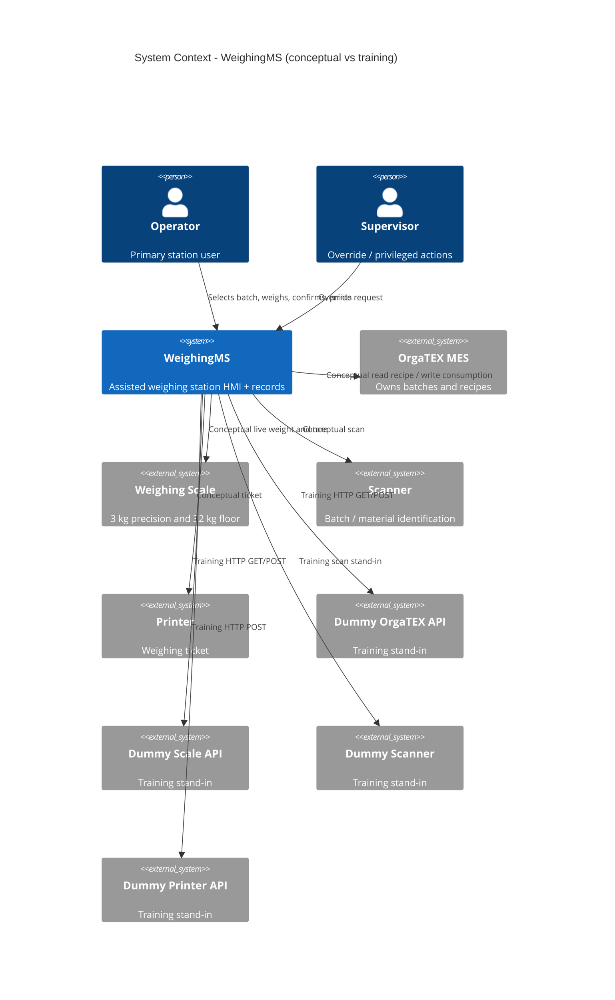

# Assisted Dyestuff Weighing Station — System Context

### Inception Progress
- [x] Intent created
- [x] Requirements gathered
- [x] UI/UX analyzed
- [ ] Generating artifacts...
    - [x] System Context  ← this step
    - [ ] Units
    - [ ] Stories
    - [ ] Bolt Plan
- [ ] Artifacts reviewed (Checkpoint 3)
- [ ] Ready for Construction

## System Overview

**WeighingMS** is the weighing-station application. It guides an operator through batch selection, component weighing, confirmation, consumption write-back, and ticket printing.

**OrgaTEX** remains the production MES. It owns batches and recipes. WeighingMS does not replace OrgaTEX.

Real OrgaTEX, scales, scanner, and printer are **not available** in this lab. Training substitutes (Dummy APIs) are product artifacts. Dummy contracts are not claims about SETEX or device vendors.

## Conceptual world vs training world

| Role | Conceptual (plant) | Training substitute | Ownership |
|------|--------------------|---------------------|-----------|
| Production MES | OrgaTEX (SETEX) | Dummy OrgaTEX API | OrgaTEX owns batches/recipes; Dummy owns seed + stored consumption |
| Station app | WeighingMS | WeighingMS (this product) | WeighingMS owns session, confirmations, local SQLite |
| Precision / floor scale | Physical indicators | Dummy Scale API | Device owns live weight; Dummy owns simulated weight |
| Scanner | Batch/material barcode | Dummy Scanner | Identification stand-in |
| Printer | Ticket/label printer | Dummy Printer API | Print job; Dummy stores ticket |
| Operator | Human at station | Same (session operator ID) | Human |
| Supervisor | Human override | Same (override request log) | Human |

## Actors

### Human

- **Operator** (primary): Selects batch, identifies component/lot/container, tares, dispenses by hand, confirms in-tolerance weight, requests print. Cannot confirm out of tolerance. Cannot complete an incomplete batch.
- **Supervisor**: Override authority and privileged actions. Training exposes override and logs the request; it does not silently confirm over-tolerance weight.

### Systems

- **WeighingMS**: The system being built (HMI + Dummy API host + SQLite).
- **OrgaTEX**: Conceptual upstream/downstream MES. Not implemented. Talked to only via Dummy OrgaTEX in training.

### Devices (conceptual)

- **Scale** (3 kg precision and 32 kg floor)
- **Scanner**
- **Printer**

### Training substitutes

- **Dummy OrgaTEX API** — `GET /api/batches`, `GET /api/batches/:id`, `GET /api/batches/:id/recipe`, `POST /api/batches/:id/consumption`
- **Dummy Scale API** — `GET /api/scales`, status, weight, tare
- **Dummy Scanner** — optional code → same selection as touch
- **Dummy Printer API** — `POST /api/tickets`

## Integration boundaries

```
                    CONCEPTUAL PLANT                         TRAINING LAB
                    ----------------                         ------------
 Operator ──┐
 Supervisor ┼── UI ── WeighingMS ──┬── OrgaTEX MES           Dummy OrgaTEX API
            │                      ├── Scale indicator       Dummy Scale API
            │                      ├── Scanner               Dummy Scanner
            │                      └── Ticket printer        Dummy Printer API
            └── (never talks to OrgaTEX except through WeighingMS)
```

Boundary rules:

1. UI does not call OrgaTEX/devices directly. It calls WeighingMS HTTP Dummy APIs.
2. WeighingMS does not embed scenario arrays as the system of record.
3. No real SETEX/scale/printer protocol is invented.
4. Failure of a Dummy is a WeighingMS-visible failure, not a silent UI fallback to hard-coded success.

## Data flows

### Inbound to WeighingMS

| From | Data | Direction | Training path |
|------|------|-----------|----------------|
| Operator / Supervisor | Batch selection, tare, confirm, quit, override, print, next batch | In | HMI |
| Dummy OrgaTEX | Batch queue, batch header, recipe components (targets, units, tols, scale assignment, lots, containers, tares) | In | GET batches / recipe |
| Dummy Scale | Scale catalogue, status, net/live weight | In | GET scales / weight / status |
| Dummy Scanner | Batch or material code | In | Dummy scan or touch equivalent |
| Dummy Printer | Print accept/reject | In | POST tickets response |

### Outbound from WeighingMS

| To | Data | Direction | Training path |
|----|------|-----------|----------------|
| Dummy OrgaTEX | Actual consumption per component, operator, timestamps | Out | POST consumption |
| Dummy Scale | Tare request | Out | POST tare |
| Dummy Printer | Ticket: batch, order, machine, shade, date, operator, component target/actual, barcode | Out | POST tickets |
| Operator | Live weight, remaining, target, tolerance state, device status, ticket preview | Out | HMI |

WeighingMS **writes** consumption and weighing status in the conceptual model. Recipe and dyestuff master remain **read-only** from OrgaTEX even in training (Dummy may seed them; the HMI must not author recipes).

## Ownership

| Data | Owner | WeighingMS may |
|------|-------|----------------|
| Batch identity, order, machine, shade, recipe | OrgaTEX (Dummy seed) | Read; mark weighing/weighed via Dummy write-back only |
| Recipe targets and component list | OrgaTEX (Dummy seed) | Read only |
| Live weight | Scale (Dummy) | Read; tare |
| Lot, container, tare used, actual weight, operator, timestamp | WeighingMS session/record | Write on confirm |
| Consumption record | Posted to OrgaTEX Dummy | Write on batch complete |
| Ticket | WeighingMS → Dummy Printer | Write |

## Failure boundaries

| Failure | Boundary | Training behaviour (FR-20) |
|---------|----------|----------------------------|
| Dummy Scale unavailable | Scale integration | No valid live weight; Confirm disabled; visible failure |
| Dummy OrgaTEX unavailable on read | OrgaTEX integration | Queue/recipe load fails visibly; no silent hard-coded queue |
| Dummy OrgaTEX unavailable on write | OrgaTEX integration | No UI CONFIRMED write-back |
| Dummy Printer unavailable | Printer integration | No silent successful print |
| Dummy Scanner unavailable | Scanner integration | Touch selection still allowed; scan failure visible if scan required |
| Out of tolerance / overshoot | WeighingMS domain | Confirm disabled; no auto recipe recalc |
| Quit / incomplete batch | WeighingMS domain | Component/batch not complete |

Full plant offline-sync (brief A-03) is **unresolved** and not a training Must.

## Context diagram



In the running lab, only the Dummy_* boxes are implemented. OrgaTEX/Scale/Scanner/Printer conceptual boxes stay unimplemented.

## High-level constraints

- Approved stack: TypeScript, Vite + React, Fastify Dummy APIs, SQLite, Vitest, Playwright, localhost.
- Do not invent real OrgaTEX contracts.
- UI must not hard-code the batch table as the live source.
- WeighingMS does not author recipes or control dispensing machines.

## Key NFR goals (training)

- Demonstrable S1–S3 workflow for B-24187
- Tolerance decisions use decimal/fixed-point
- Dummy failures are visible and safe
- Playwright covers the happy path

## Trust boundary

Operator/Supervisor → WeighingMS HMI is the only human interface. Dummy APIs are trusted only as training doubles. Nothing from Dummy OrgaTEX is treated as a documented SETEX interface.
